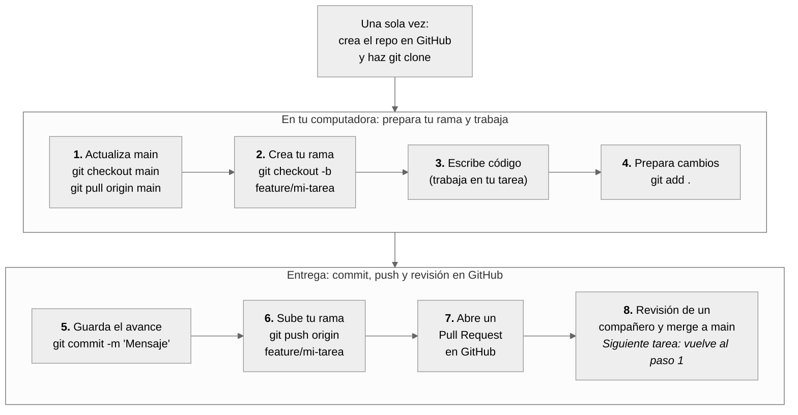

# Taller de Git — Métodos de Desarrollo Ágil

Material completo del taller de Git trabajado en clase: control de versiones, ramas, colaboración en equipo con GitHub, y resolución de conflictos. Construido y afinado en vivo, sesión por sesión — varios de los detalles que encontrarás aquí (los warnings, los errores de permisos, el protocolo de equipo) salieron de tropiezos reales durante la ejecución del taller, no de un plan de escritorio.

## Resumen visual del flujo de trabajo

Este es el ciclo que vas a repetir para cada tarea, del inicio a fin del semestre: partir de `main` actualizado, crear tu rama, trabajar, subir tu rama (nunca `main` directamente), y fusionar vía Pull Request con revisión de un compañero.

## Contenido y ruta sugerida

| Orden | Documento | Qué cubre |
|---|---|---|
| 1 | [**Guía de Laboratorio — Sesiones 1, 2, 3 y 5**](01-Guia_Laboratorio_Sesiones_1_2_3_5_2.md) | Fundamentos y configuración, flujo local (commits, historial), ramas, y — al final del taller — rastreo de autoría y cierre. Cada sesión termina con un checkpoint verificable. |
| 2 | [**Tarjetas de Tarea — Sesión 4**](02-Tarjetas_de_Tarea_Sesion4_4.md) | La práctica de colaboración en equipo: cada integrante trabaja su propia rama sobre el proyecto de ejemplo, sube su Pull Request, y cierran con un conflicto de fusión provocado a propósito, en entorno controlado. |
| 3 | [**Preguntas Frecuentes y Modelos Mentales**](03-FAQ_Modelos_Mentales_Git_2.md) | Referencia rápida de consulta continua — el protocolo de equipo resumido, y las dudas y errores reales que fueron saliendo durante el taller (permisos, warnings de finales de línea, rechazos de `push`, entre otros). |
| 4 | [**Proyecto de práctica**](04-ejemplo-sistema-inscripcion-starter.zip) | El mini sistema de inscripción escolar (HTML/CSS/JS, sin instalación) usado como base para la Sesión 4 — cada tarjeta de tarea trabaja sobre estos archivos. |

**Cómo recorrerlo:** sigue la Guía de Laboratorio en orden (Sesiones 1 → 2 → 3), pausa ahí para trabajar la Sesión 4 con las Tarjetas de Tarea y el proyecto de práctica, y cierra de vuelta en la Guía con la Sesión 5. Ten el FAQ abierto en paralelo desde la Sesión 4 en adelante — ahí es donde más dudas conceptuales suelen aparecer.

## El protocolo de equipo, en una línea

Nadie hace `push` ni `merge` directo a `main` — ni local ni en la nube. Siempre: rama → commits → `push` de la rama → Pull Request → revisión de un compañero → merge desde GitHub. El detalle completo está en el FAQ.

---

*Material vivo: si en un semestre futuro aparece un tropiezo nuevo, la fórmula que mejor funcionó fue documentarlo en el momento, con el mensaje de error real incluido — así el material sigue creciendo con cada generación de alumnos.*
